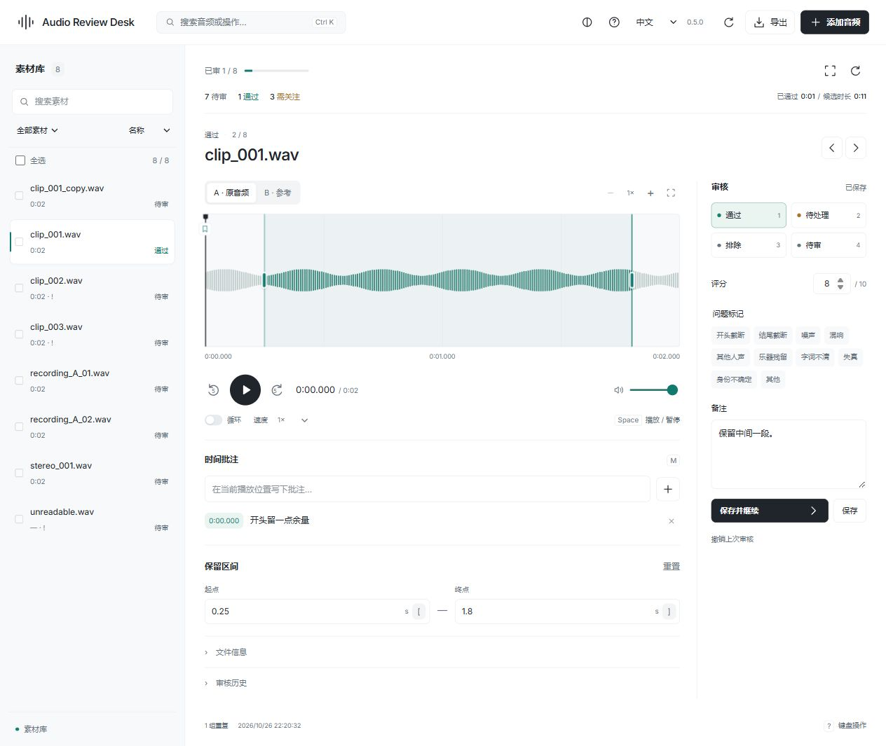

# Audio Review Desk

选一批音频，逐条试听，在波形上留下区间和时间批注。审核结果可以继续编辑，也能导出给后续工具。

[English](docs/README.en.md) · [安装](docs/installation.md) · [清单格式](docs/manifests.md) · [版本记录](docs/releases/README.md)



截图使用生成的测试信号，审核内容仅作操作示例。

## 开始使用

Windows 下载并解压 [最新源码包](https://github.com/FUN-ACTION/audio-review-desk/releases/latest)，双击 `start-windows.cmd`。需要 Python 3.11 或更新版本。

macOS / Linux：

```sh
git clone https://github.com/FUN-ACTION/audio-review-desk.git
cd audio-review-desk
python3 -m venv .venv
.venv/bin/python -m pip install .
.venv/bin/python -m audio_review_desk serve --workspace review-workspace --open
```

选择音频文件、文件夹或已有清单。多个文件可以一起选择；手动输入时每行一个路径。PCM WAV 直接可用，其他格式需要 [FFmpeg 与 ffprobe](docs/installation.md#optional-ffmpeg)。

## 审核一批音频

先从左边找文件。可以搜索名称，筛出电平异常、重复项或待处理项，也可以按最近审核排序。Ctrl / ⌘ K 可以直接搜索文件和常用操作。

播放时切换 A / B 对照参考，放大波形找边界。拖动两端指定保留区间，或打开循环、降低速度反复听。遇到需要回看的位置，按 M 写下批注；点击时间即可跳回去。

右边保存通过、待处理或排除决定，再继续下一条。选错可以撤销，之前的记录仍在历史中。批量标记保留原备注和分数，通过决定逐条填写。

导出通过项 CSV 交给后续工具，或用 JSON 保存完整审核。导出包含区间、时间批注和版本信息。

## 记录如何保留

原音频只供读取，区间是保存的建议。数据库和试听副本位于独立工作区。替换音频或参考文件后，新的版本回到待审，旧审核仍留在历史中。

同一来源的重叠区间合并统计；PCM 重复检测是另一项统计。规则见 [时长与精度](docs/counting.md)。清单可提供稳定的片段 ID、来源时间和参考文件；需要移动素材时建议使用清单。

## 更新

0.5 增加多文件导入、时间批注和快捷操作，重新整理了界面与双语提示，动效使用随包提供的 Motion。[本版变化与升级步骤](docs/releases/0.5.0.md)中记录了兼容处理；[设计笔记](docs/design.md)列出参考和实现。

升级前停止旧服务，备份整个工作区，在应用原有虚拟环境中安装新版，再指定原路径启动。每个版本都有独立说明。

## 开发

```sh
python -m pip install -e .
python -m unittest discover -s tests -v
node --test tests-js/*.test.mjs
```

测试使用临时工作区和生成信号。Node.js 22+ 用于前端测试；正常使用无需安装 Node.js。Motion 已打包进应用，维护者升级它时才需要重新构建。

提交问题时，请附上复现步骤和可以公开的小样例。见 [贡献说明](CONTRIBUTING.md) 与 [验证记录](docs/verification.md)。代码使用 MIT 许可；随附字体及 Motion 的许可见 [第三方说明](THIRD_PARTY_NOTICES.md)。
