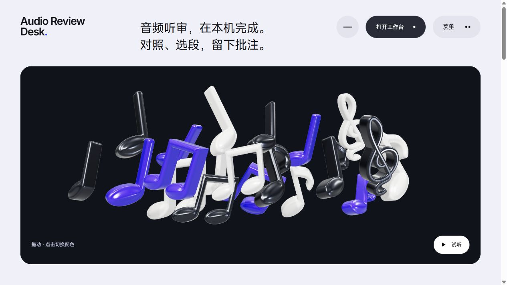

# Audio Review Desk

逐条听音频，比较参考版本，保存区间和批注。审核记录可导出为 CSV 或 JSON。

[English](docs/README.en.md) · [安装](docs/installation.md) · [清单格式](docs/manifests.md) · [0.11 更新](docs/releases/0.11.0.md)

[](https://fun-action.github.io/audio-review-desk/tour/)

[打开项目展示页](https://fun-action.github.io/audio-review-desk/tour/) · [工作台截图](docs/screenshot-zh-CN.png)

## 开始使用

Windows：下载并解压[最新源码包](https://github.com/FUN-ACTION/audio-review-desk/releases/latest)，双击 `start-windows.cmd`。需要 Python 3.11 或更新版本。

macOS / Linux：

```sh
git clone https://github.com/FUN-ACTION/audio-review-desk.git
cd audio-review-desk
python3 -m venv .venv
.venv/bin/python -m pip install .
.venv/bin/python -m audio_review_desk init --workspace review-workspace
.venv/bin/python -m audio_review_desk serve --workspace review-workspace --open
```

打开后选择音频文件、文件夹，或 CSV / JSON 清单。可以一次选择多个文件。普通 PCM WAV 直接可用；其他格式需要 [FFmpeg 与 ffprobe](docs/installation.md#optional-ffmpeg)。

## 从试听到导出

左边找文件，中间听，右边留下决定。搜索可以同时匹配文件名、备注和时间批注；按 Ctrl / ⌘ K 可直接打开音频或执行常用操作。

| 操作 | 用法 |
| --- | --- |
| 对照试听 | 切换 A / B，比较原音频和清单中的参考版本；可以调速或循环播放 |
| 留下批注 | 按 M，在播放位置写批注；点时间跳转，点文字修改内容和时间 |
| 确定区间 | 拖动波形两端，或用 `[` / `]` 标记当前播放位置 |
| 保存决定 | 通过、待处理或排除；“保存并继续”跳到下一条待审音频 |
| 导出记录 | 导出通过项 CSV，或用 JSON 保存完整审核；两者都包含区间和批注 |

保存过的审核可以撤销，之前的版本仍在历史里。批量标记保留备注和分数，通过决定逐条填写。播放位置、速度和音量会在这个浏览器里记住；播放位置记忆可在帮助中关闭。

## 更新与记录

0.11 恢复浅紫布局与 MiSans 字体，把首屏换成可拖动的立体音符。下方改为三组实时生成的视觉画布，不再放操作录像和示例界面。[本版说明](docs/releases/0.11.0.md)包含变化与升级步骤。

原文件只供读取，保留区间不会裁剪音频。数据库、审核历史和试听副本位于独立工作区。升级前停止旧服务，备份**整个工作区**，在应用原有虚拟环境中安装新版，然后指定原路径启动。[每个版本](docs/releases/README.md)都有独立的升级说明。

音频或参考版本变化后，新版本重新进入待审。移动文件时建议使用清单中的稳定 ID。重叠区间和重复音频的统计规则见[时长与精度](docs/counting.md)。

## 开发

```sh
python -m pip install -e .
python -m unittest discover -s tests -v
node --test tests-js/*.test.mjs
```

测试使用临时工作区和生成的信号，演示中的分数和批注用于说明操作。Node.js 22+ 仅用于前端测试，日常使用无需安装。

提交问题时请附上复现步骤和可公开的小样例。见[贡献说明](CONTRIBUTING.md)、[验证记录](docs/verification.md)和[第三方许可](THIRD_PARTY_NOTICES.md)。代码使用 MIT 许可。
