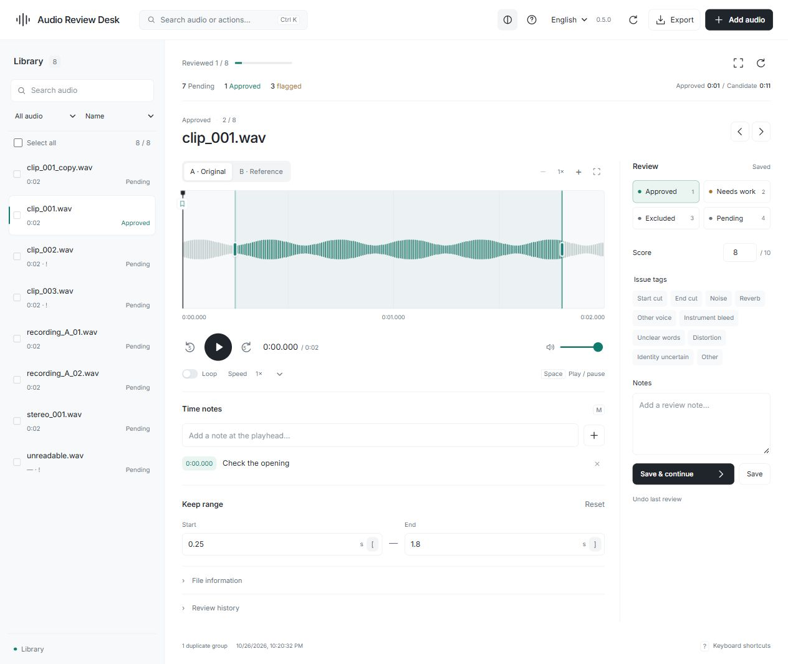

# Audio Review Desk

Review a collection of audio clips, compare references, and leave keep ranges and timestamped notes. Export the decisions when the collection is ready for the next tool.

[中文](../README.md) · [Install](installation.md) · [Manifest format](manifests.md) · [Release notes](releases/README.md)



The screenshot uses generated signals and illustrative decisions.

## Start

On Windows, unzip the [latest source release](https://github.com/FUN-ACTION/audio-review-desk/releases/latest) and run `start-windows.cmd`. Python 3.11+ is required.

On macOS or Linux:

```sh
git clone https://github.com/FUN-ACTION/audio-review-desk.git
cd audio-review-desk
python3 -m venv .venv
.venv/bin/python -m pip install .
.venv/bin/python -m audio_review_desk serve --workspace review-workspace --open
```

Choose audio files, a folder, or a CSV/JSON manifest. Multiple files can be selected together; manual paths go on separate lines. PCM WAV works directly. Other formats need [FFmpeg and ffprobe](installation.md#optional-ffmpeg).

## Review a collection

Search and filter the library, or sort by recent reviews. Ctrl / Cmd K searches clips and actions. Switch A/B to compare a reference, zoom into the waveform, and drag the keep-range handles. Loop or slow a phrase down when needed.

Press M to add a note at the playhead. Click its timestamp to return there. Save a decision in the inspector and continue to the next clip. Undo restores the previous review without deleting history. Batch changes retain notes and scores; approval is per clip.

Export approved clips as CSV, or save the full review data as JSON. Both include time notes. See [counting and precision](counting.md) for source overlap and PCM comparison rules.

## Files and updates

Source files are read-only. The workspace holds the database and listening copies. A replacement clip or reference starts a new review version; previous decisions remain in history. Use stable manifest IDs when moving files between locations.

Version 0.5 adds multi-file selection, timestamped notes, a command menu and a rebuilt interface using bundled Motion. See [changes and upgrade steps](releases/0.5.0.md). Stop the old server, back up the entire workspace, install in the app's existing environment, and reopen the original workspace path.

## Development

```sh
python -m pip install -e .
python -m unittest discover -s tests -v
node --test tests-js/*.test.mjs
```

Tests use temporary workspaces and generated signals. Node.js 22+ is for frontend tests; normal usage needs no Node installation. See [contributing](../CONTRIBUTING.md), [verification](verification.md) and [third-party licences](../THIRD_PARTY_NOTICES.md).
