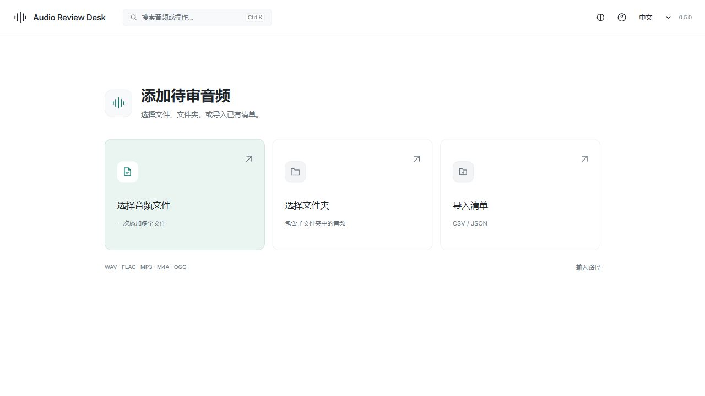
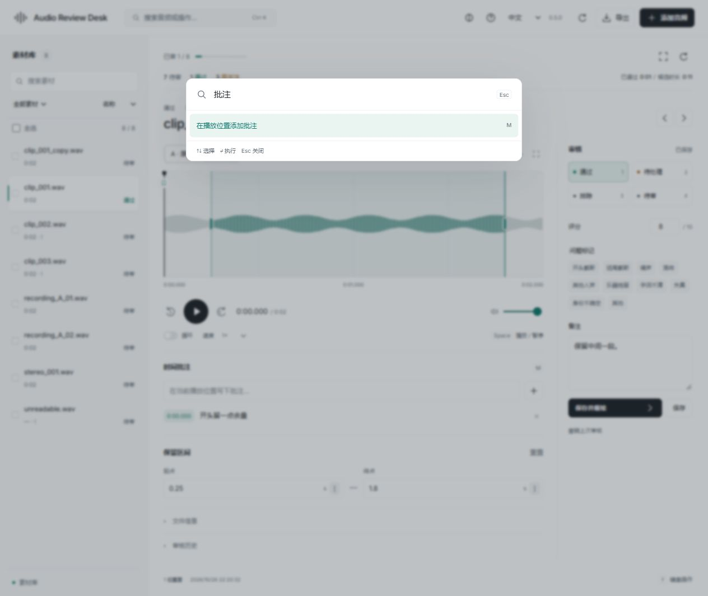

# Interface notes

## Reference and reuse

[Linear's UI redesign account](https://linear.app/now/how-we-redesigned-the-linear-ui) informed alignment, navigation density and the separation of the file list from the inspector. Its live article was inspected: it used Inter, size-specific tracking, 48 px article titles and 24 px section headings. Those are observations of the article, not measurements of the signed-in application.

[Superlist's 2021 award record](https://www.awwwards.com/unseenstudio/?library=true&previewmode=true) was reviewed as a historical reference for grouping and interaction. Its current site has changed. No claim is made that the current site is the awarded build.

The earlier [Lusion study](https://lusion.co/) inspected its custom Tween class, central animation loop, text layers and repeated easing curves. In this editor, continuous selection and clear panel transitions are useful; native list scrolling stays available.

Version 0.5 directly reuses the MIT-licensed [Motion library](https://motion.dev/docs/animate). The full and mini APIs are bundled locally: numeric motion values drive the A/B and library indicators; native style animation handles dialogs, feedback and intake entry. Versions, source lock, licences and output hash are committed. No code, font or paid template from the reference sites is distributed.

## Structure and type

The app has a 64 px toolbar, a scrollable library, a listening area and a review inspector. The empty library uses a compact source selector rather than a marketing heading. Status and progress have one header row. Audio IDs stay out of the main title.

Inter handles Latin; Chinese interface text prefers the platform UI font, with bundled Noto Sans SC as a fallback. Chinese headings use normal tracking. The intake title is 27 px, clip titles 23 px, controls mostly 12–14 px. A narrow viewport stacks the inspector and collapses the library after selection.

## Motion behaviour

- Selected library rows share one moving highlight. Motion values retain current position and velocity when interrupted.
- Dialogs enter in 220 ms and leave in 140 ms. The transform ends at explicit identity. Opening a dialog invalidates an earlier close callback before stopping its animation.
- Intake cards enter with short staggered offsets; pointer hover shifts them by two pixels. Keyboard actions are immediate. Reduced motion bypasses these transitions.
- Playback comes from the audio clock. Seeking and boundary dragging track input directly. Pointer capture retains the grab offset; waveform bars do not repaint on each playback frame.

## Language and annotation data

Visible labels, accessibility names and known API/job errors have both languages. Error codes choose UI text; raw command-line diagnostics do not appear as English messages in a Chinese workflow. Filenames and user-written notes are retained as entered.

Time notes are version-bound review fields. Their text is rendered with `textContent`, and their timestamp buttons seek the player. A note being composed is protected as a draft and included when saving. The waveform remains a peak overview; zoom does not add sample-level detail or edit the source audio.

## Views

